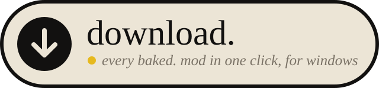

  

# baked. fully baked tool

Installs every baked. mod into ReSkate, plus a few we recommend. Run it again any time to get new packs and updates.

## How to use it

1. Click the big button above. It downloads `fully-baked-tool.zip`.
2. Close skate. and the ReSkate launcher.
3. Open your Downloads folder and double-click the zip to open it.
4. Double-click `FullyBaked.bat` inside it.
5. Press **Y** when it shows your ReSkate folder. If it can't find it, drag your ReSkate folder onto the window and press Enter.

## Windows asks if you want to run it?

That's normal for a small tool like this that nobody paid to sign.

- **"Do you want to run this file?":** click **Run**.
- **"Windows protected your PC":** click **More info**, then **Run anyway**.
- **Your browser warns about the download:** choose **Keep**.

## Need help?

Ask in the baked. Discord: https://discord.bakedskate.org
